# Live background styles: industrial and premium (2026-10-14)

Ten styles, one 412x915 frame each at t=7.3 s, idle, strength 1 (so at the 6 % dark / 4.5 % light ceiling). Real goldens from test/kit_live_styles_industrial_test.dart.

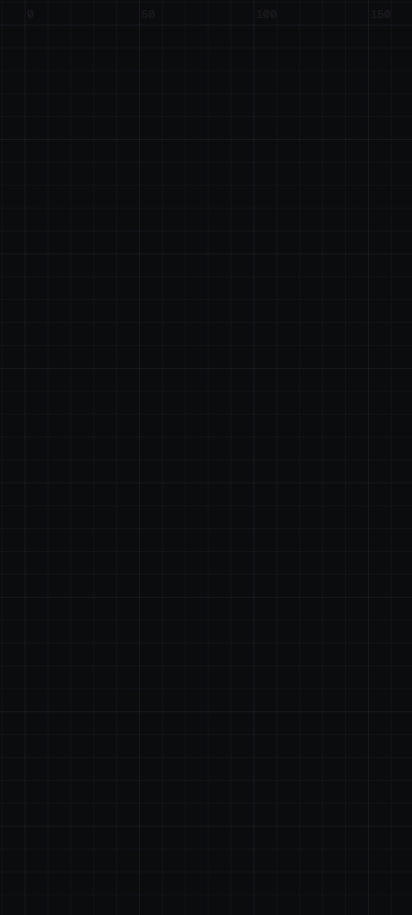

blueprint_dark

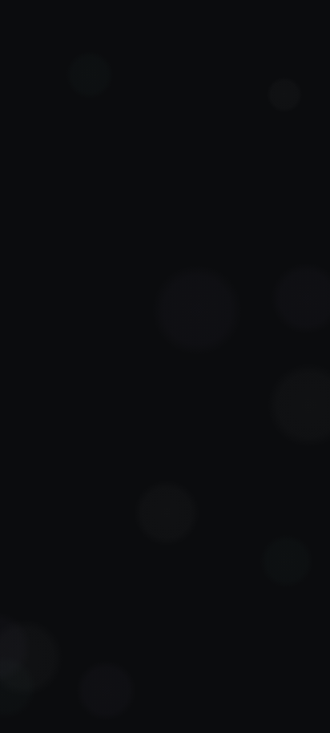

bokeh_dark

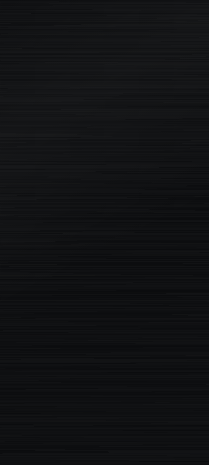

brushedMetal_dark

caustics_dark

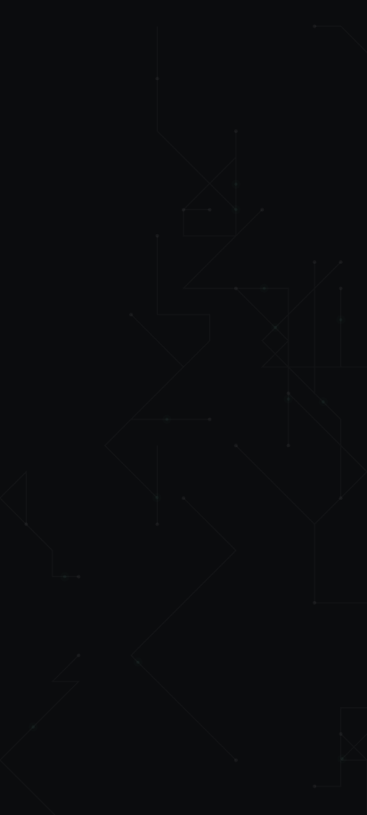

circuit_dark

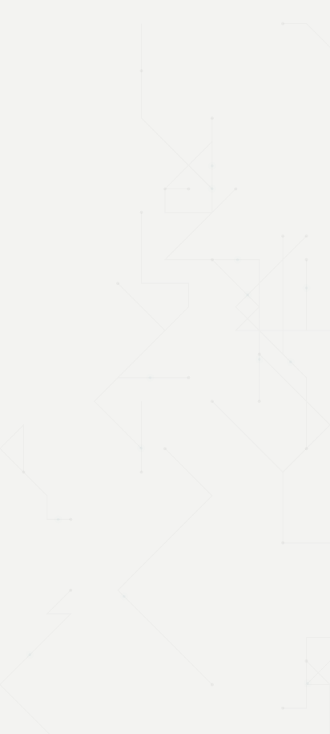

circuit_light

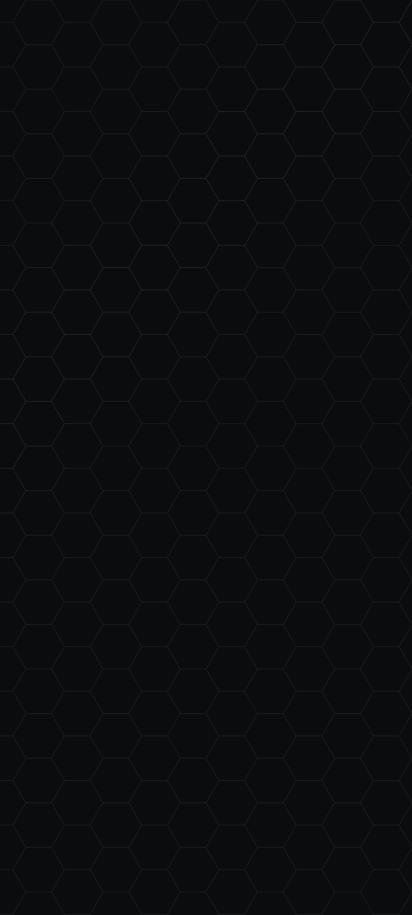

honeycomb_dark

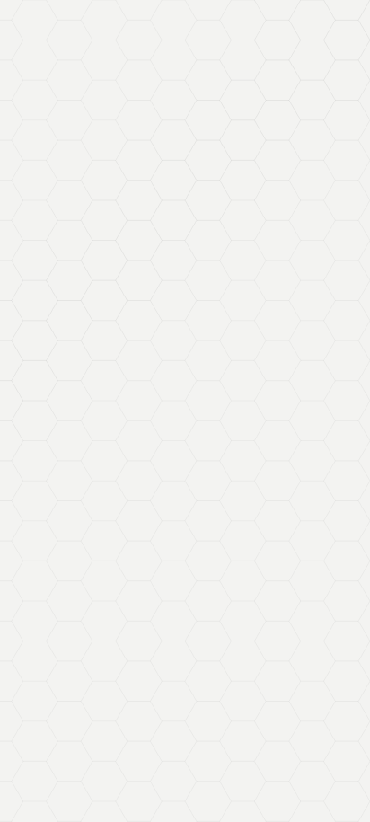

honeycomb_light

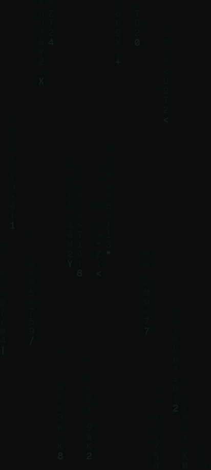

matrixRain_dark

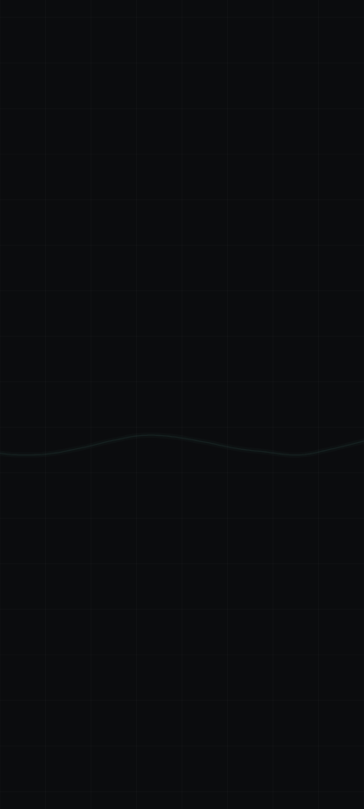

oscilloscope_dark

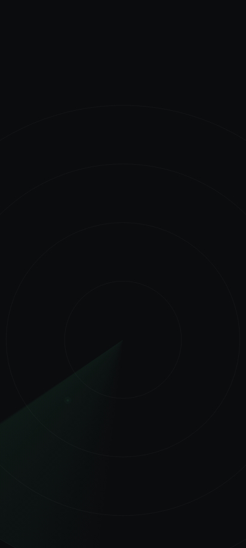

radar_dark

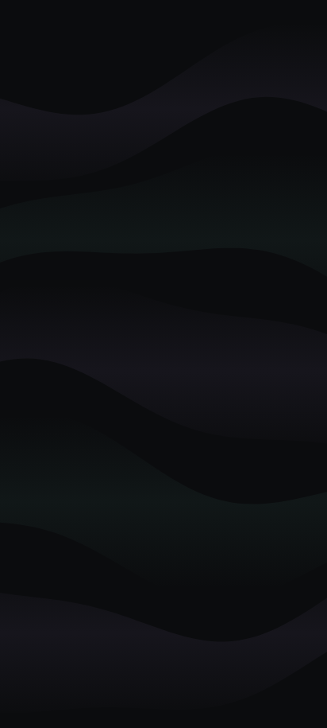

silk_dark

Factor 2 (matrixRain, blueprint, circuit, oscilloscope, radar, honeycomb) and factor 1 (the rest), via ceilingFactor. Matrix rain defaults to half-width katakana plus digits and symbols with a system CJK fallback; the goldens use the ASCII glyph set (KitLiveMatrixRain.asciiGlyphs) so they do not depend on a system font. Honeycomb base is limited by doubled shared edges.
