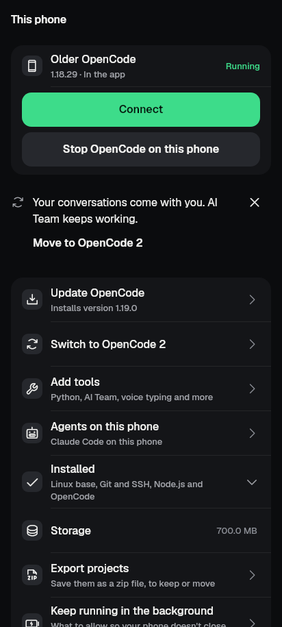
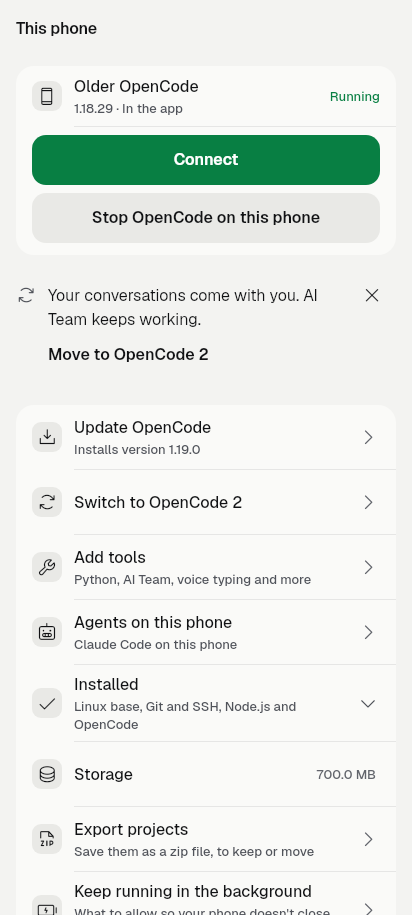

# Move to OpenCode 2: the one quiet line (retirement phase 3, 2026-10-15)

Finish line: a phone server the app manages (in-app or Termux) that still runs the older OpenCode shows one offer on its own
page, "This phone", with a one-tap switch through the existing flow. Non-goals: banners, badges, repeated prompts, remote
servers, removing the older OpenCode.

## What a person sees

- **Where:** the notice slot of This phone, between the status panel and the list (the same slot as the free-model notice). It is
  the kit's one-sentence offer: "Your conversations come with you. AI Team keeps working." with **Move to OpenCode 2**, and a
  close ("Not now" to screen readers). No new bar, row or level; the list's own "Switch to OpenCode 2" row is unchanged.
- **Only when:** this phone's own server runs the older OpenCode, can switch, is not busy or half switched, and was not dismissed.
  An OpenCode 2 server and any remote server (which has no This phone page) show nothing.
- **Not now** folds the line away (`KitReveal`, 250 ms, instant under reduced motion) and saves `oc.moveToOpenCode2Dismissed.<profileId>`.
  The profile-scoped sweep removes it with the server. The line never comes back for that server.
- **Move** opens the existing confirm sheet and then the existing switch job. The sheet used to say "Conversations ... stay
  separate", which is false in this direction since the history copy; it now says (`setupSwitchToTwoDetail`): "Stops this phone's
  server and running tasks, then starts OpenCode 2. Your conversations come with you and AI Team keeps working. You can switch
  back." Switching to the older OpenCode keeps the old sheet text.
- Copy: en and ar ARB, gen-l10n run once.

## Switch flow audit (what I checked and what I fixed)

| Concern | Finding |
| --- | --- |
| History | Already copied by both start paths (`opencode_history_copy.dart`), proven in `docs/qa/oc2-switch-keeps-chats-2026-10-14/`. |
| gen-UI plugin | Follows the connected profile's flavor (`AgentToolAdapters.forOpenCode(v2: ...)` in `connection/gen_ui.dart`), so it moves with the connection. |
| Quota collector | Reads both auth paths, ordered by flavor (`quota_collector_host.dart`); restarts with the server (`InAppQuotaCollector.restartIfSetUp`). |
| **AI Team** | **Gap found and fixed.** One saved server exists per runtime, and the team config (`orchestration`, `teamEngineAuth`) lives on the profile, so the new OpenCode 2 profile started with the team off. `teamFollowsRuntime` now moves the config to the new profile when the in-app finisher or the Termux switch job picks it (a target with its own config keeps it; remote servers are untouched). The start that follows brings the team service back because the profile carries the built-in config. The team service itself stays up; the engine talks to the new server through its own client. |
| Switching back | "Older OpenCode" row unchanged; the same carry runs the other way, and the in-app/Termux guards (`canSwitchRuntime`, legacy OpenCode 2 lock) are untouched. |

Not proven here: a live in-app switch with a team running on the emulator (no emulator run in this slice; the owner tests). The
team carry is proven at the finisher level with a fake Linux.

## Tests

- `test/move_to_opencode2_line_test.dart` (9): line for managed older server in the app and in Termux; none for OpenCode 2; Not now
  hides and saves; stays dismissed on reopen; another server's dismissal does not count; tap opens the sheet with the new text and
  confirming runs the `opencode` install with `runtime=opencode2`; cancelling keeps the line; key swept with the profile.
- `test/team_follows_runtime_test.dart` (2) and the new case in `test/setup_finish_host_test.dart` (fails with the
  `setup_finish.dart` change reverted, watched).
- Goldens regenerated and looked at: `test/revamp/goldens/phone_this_phone_running_{dark,light,1280x800_dark}.png` and
  `phone_this_phone_remove_confirm_{dark,light}.png` (the older-OpenCode page now carries the line).

## Images

One real phone-size screen each (412x915, app fonts):

The older OpenCode, running; the line sits under the status panel with its close.

Same screen, light.
