# Home-screen widgets v2: the Flutter side (2026-10-15)

Branch `feat/widgets-v2-ui`, on Codex's native backend (916ca71e4). Contract:
`docs/design/widgets-v2-contract.md`.

## What is real and what is a mock

Every image below is a **Flutter golden render at 412x915** of the real Dart
screens, with a stand-in gradient where the launcher would be (the real window
is transparent). They are **not** screenshots from a phone or emulator. The
real window sets `FLAG_SECURE`, so device screenshots of it come out black.

The widget drawing inside the style window (`preview-layouts-dark.png`) is a
**mock built from kit parts**, not the launcher's `RemoteViews` render. There
is no Robolectric/Kotlin renderer in this repo, so the real launcher layouts
(1x1, 2x2, 4x2) still need an emulator. For the "wallpaper" accent the mock
cannot know the phone's colours; it draws a neutral stand-in, and "app theme"
draws the app accent.

## Implemented

| Piece | Where |
| --- | --- |
| Entry point `widgetOverlayMain` | `lib/main.dart` -> `lib/widgets_overlay/widget_overlay_app.dart` (own MaterialApp, no connection controller, no secure storage) |
| `/widgets/configure` | `lib/ui/screens/widgets/widget_configure_screen.dart` + `WidgetStyleController` |
| `/widgets/steer` and `/widgets/voice` | `lib/ui/screens/widgets/widget_steer_screen.dart` + `WidgetComposeController` |
| New kit parts | `KitFloatingPanel`, `KitSteerBox`, `KitWidgetPreview`, `KitWidgetStyleForm` (exported, doc rows in `kit.dart`) |
| Kit change | `KitSwatch.accent(colorsAnotherSurface:)`: the widget's amber preset is a choice for another surface, so it is not held to LOOK-39's distance from the theme's attention colour |
| Copy | `widgetV2*` in `app_en.arb` and `app_ar.arb` (16 new keys), gen-l10n run once |
| Native gate | `WIDGET_OVERLAY_READY` is now `true`; `configuration_optional` removed from both widget infos so placement opens the style window (reconfigure kept) |
| Snapshot publisher | Already in the backend commit: `lib/state/connection/widgets.dart` publishes on state change only; no `Timer` or polling. Nothing to add. |
| G7 fix | `safeWidgetTitle` no longer uses `⁦` escapes in a regex (G7 flagged them); same behaviour, tested by the existing contract tests |

Behaviour: steer title follows `steerMode` ("Add to this turn" for steer,
"Send after this reply" for OpenCode 1); `restart` and `unknown` cannot send
and say why; dictation fills the field and never sends; voice opens dictation
at once and waits for Send; one send at a time; a rejected send keeps the draft
and says why in words; an uncertain send (or a channel error after dispatch)
shuts the box and shows `widgetV2Uncertain`; accepted shows a check, then
closes after 0.7 s. Motion: 150 to 250 ms framework animations only
(`KitMotion.quick/standard`), all instant under reduced motion; no loops.

## Images

| | Dark | Light |
| --- | --- | --- |
| Style window | 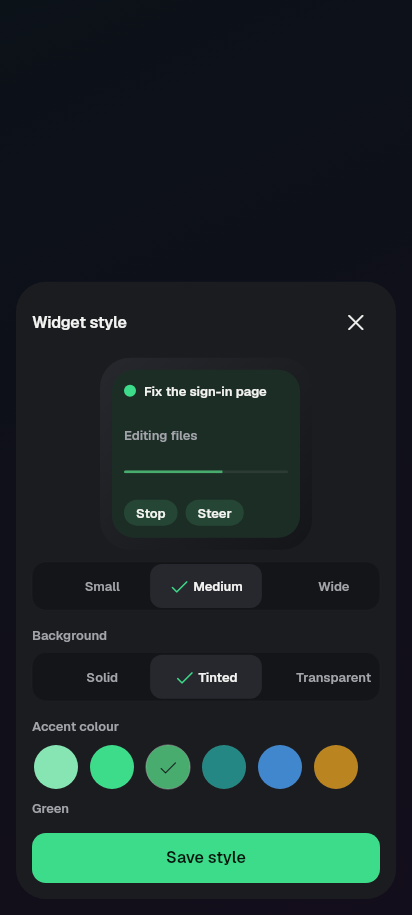 | 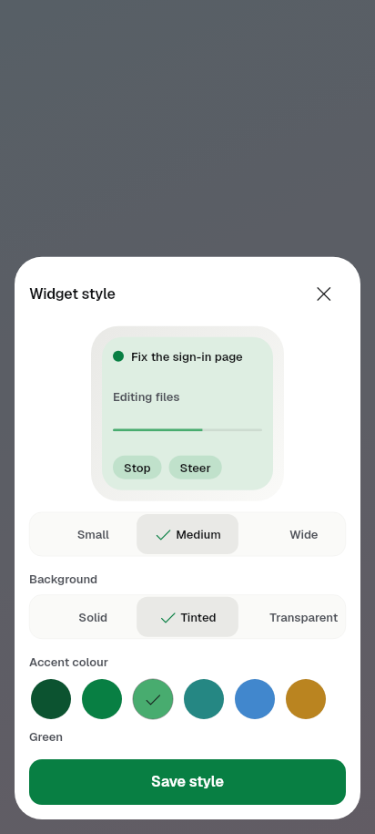 |
| Steer box, "Add to this turn" | 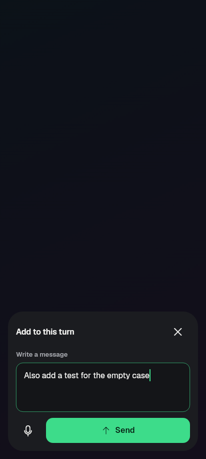 | 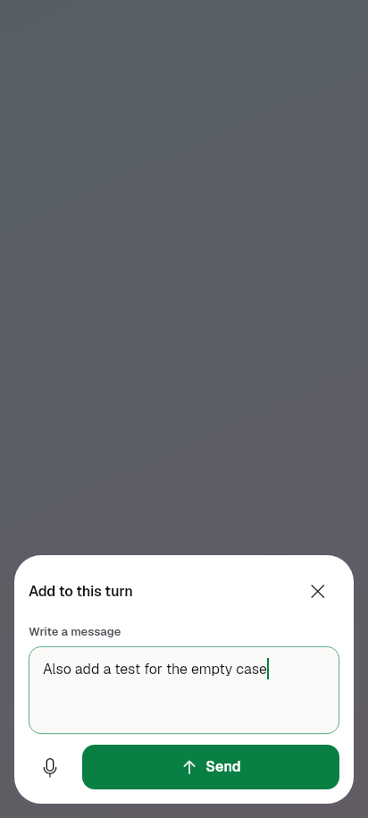 |
| Steer box, OpenCode 1 "Send after this reply" | 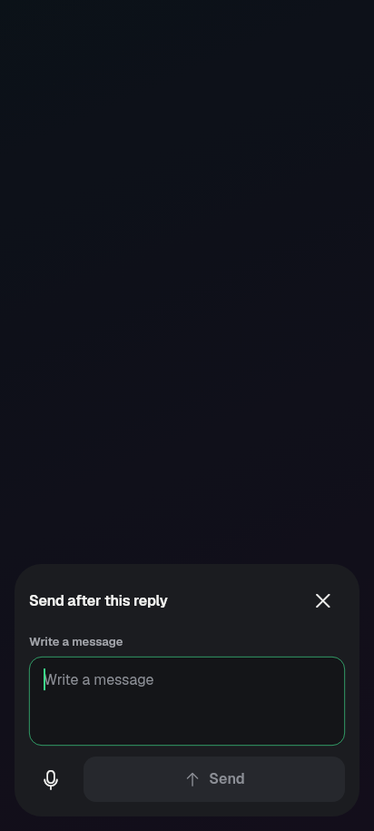 | 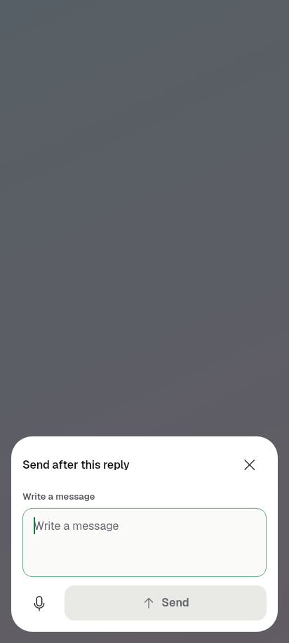 |
| Send refused, draft kept | 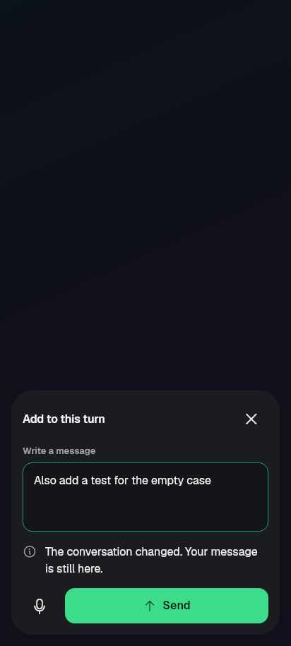 | 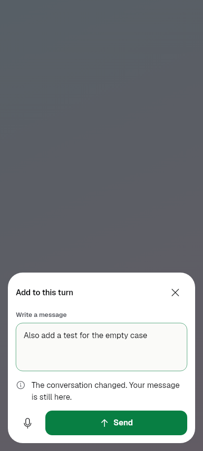 |
| Voice box after dictation | 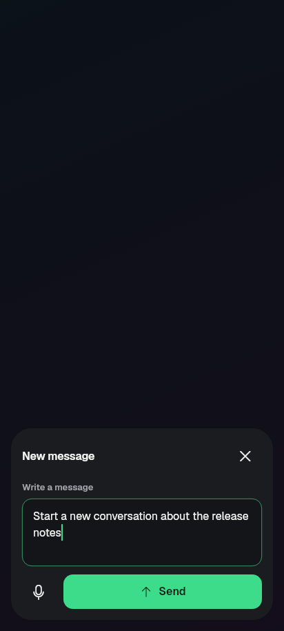 | 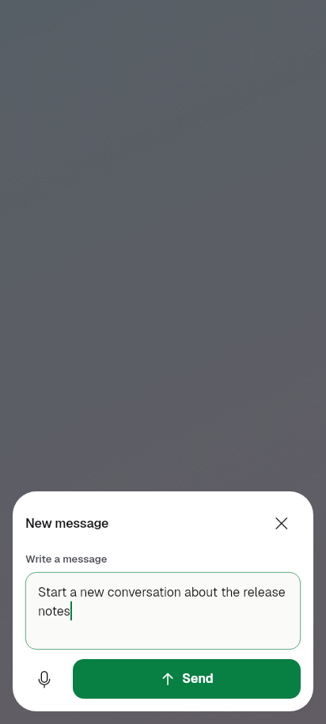 |

Widget drawing at the three layouts (mock): 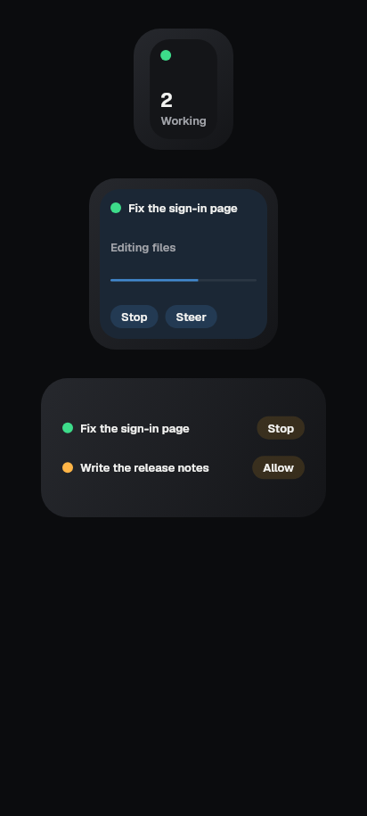

## Checks run

- Codex's 17 contract tests (`test/widget_v2_contract_test.dart`) plus
  `widget_snapshot_test`, `profile_deletion_test`, `background_action_test`,
  `background_live_test`, `background_coding_alert_test`,
  `usage_widget_snapshot_test`, `codex_steering_test`,
  `paseo_midturn_send_test`: all pass on the build server, no fix needed.
- New: `test/widget_overlay_test.dart`, `test/kit/kit_widget_preview_test.dart`,
  `kit_floating_panel_test.dart`, `kit_steer_box_test.dart`,
  `kit_widget_style_form_test.dart` (each with the reduced-motion samples),
  goldens `test/goldens/kit/kit_{widget_preview,floating_panel,steer_box,widget_style_form}_*`
  (all states, dark/light, 412x915 + 1280x800, 2.0 text) and
  `test/goldens/widget_overlay_*`.
- `kit_ratchet_test`, `kit_motion_test`, `text_scale_overflow_test`,
  `ui_glossary_test`, `l10n_coverage_test`, `file_size_ratchet_test`,
  `kit_keyboard_test`, `kit_swatch_test`: pass. `kit_manifest_test` fails on one
  entry that is not ours: `KitLiveLookPreview` lacks `disabled` goldens (from the
  live-background commit). Our four parts pass every manifest check.
- `flutter analyze lib test`: no issues. (`widgetbook/` reports errors because
  its own packages are not fetched in this worktree; unrelated.)

## Still needs an emulator (contract acceptance plan, steps 5 to 7)

Placing a widget opens the style window and Save redraws only that widget;
cancel on placement; rotation and recreation of the host; real dictation and
the system microphone prompt; keyboard lift on a real phone; transparent host
over a light and a dark wallpaper; RTL; the real launcher renders of the
1x1/2x2/4x2 layouts and the wallpaper accent.
